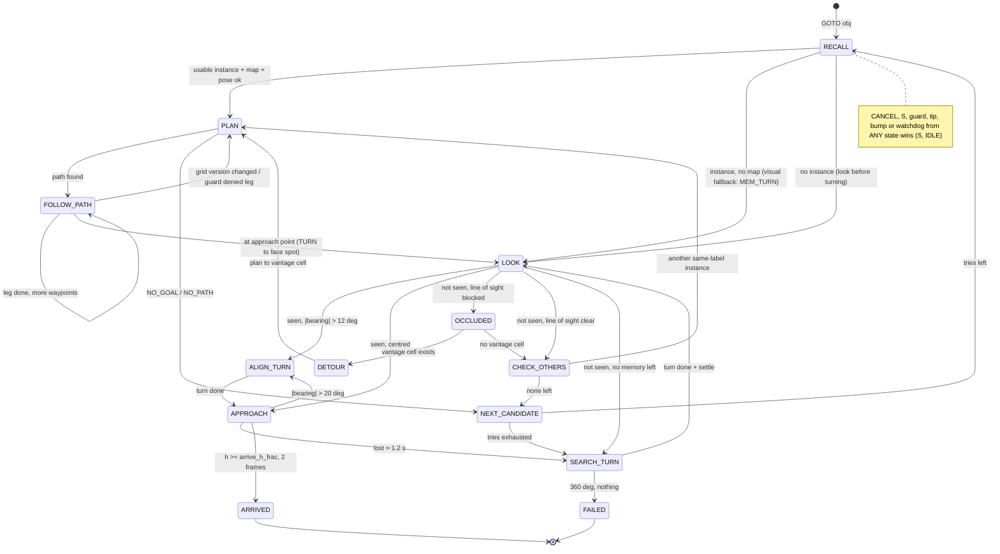

# TARS architecture: voice + YOLO + iPhone LiDAR, QNX native

This is the design for the whole robot. It covers how the three sensing layers split the work, the feature list with honest status, the one behaviour state machine, pose, ports, CPU and what has actually run.
Rules for changing code are in [AGENTS.md](../AGENTS.md). Status and priorities are in [PLAN.md](../PLAN.md).

```
 USB mic        C270 / phone RGB            iPhone 17 Pro (ARKit + LiDAR, USB)
    │                 │                               │
    ▼                 ▼                               ▼
 voice (C)       detect (C++, YOLO-World)       phone feeds 5561 / 5562
 INTENT          RECOGNITION + DOCKING          GEOMETRY
 "go to the bin" label, bearing, box height     pose, occupancy grid, obstacles
    │ GOTO/SCAN/…     │ JSON dets                     │ LDR1 / world obs
    └────────────►  goto (C)  ◄───────────────────────┘ (via goto/nav.c)
                    object memory + nav + behaviour state machine
                        │ TURN / MOVE / DL / S / BEEP / LED   (TCP 5555)
                        ▼
      lidar_guard (C++, SCHED_RR) ──GAT1 5568──► tars_motor (C, SCHED_RR 30)  ◄── SAFETY FLOOR
                                                     │ USB serial 115200
                                                     ▼
                                                 Uno: steppers, tip/bump, 200 ms watchdog
```

Everything in that picture runs on the Pi 5 under QNX 8.0 in C/C++. Andrew's Python dashboard and `mapping.py` are desktop/diagnostic visualization only (§6).

## 1. Sensor-fusion contract

Each layer answers one question and nothing else.

| Layer | Answers | Owns | Does **not** do |
|---|---|---|---|
| **Voice** (`voice/`) | *What* to do, and *to which object* | intents, wake word, the stop-first safety pass | steering, geometry |
| **YOLO** (`goto/detect`, YOLO-World) | *Which pixels are the object*, how centred, how close | label, confidence, fine bearing (box centre), arrival (box height ≥ `arrive_h_frac`) | metric position, obstacles |
| **iPhone LiDAR + ARKit** | *Where am I, where are the walls, where is the object in the room, is it hidden or gone* | robot pose, 10 cm occupancy grid, object world (x,z), line-of-sight checks | recognising objects, deciding arrival |
| **tars_motor + lidar_guard** | *May the wheels move right now?* | guard gate, watchdog, tip/bump, S-wins | anything above |

**The fusion point is the object-memory entry** (from `kothar/object-memory`, `goto` side):

```
instance  = label#id                      # from YOLO   ("trash can#2")
world     = (x, z) at the sighting        # from ARKit pose + bearing + range (dead-reckoning fallback)
status    = fresh | stale | gone          # from re-observation (YOLO) and line of sight (map)
bearing   = world bearing of last sighting
dist, conf, seen count, last_seen
```

**The map gets the robot near; YOLO confirms and docks.** The planner drives to a 0.6–0.85 m approach ring around the remembered `world`, then the existing visual servo takes over for the last metre. Nothing is ever declared ARRIVED on the map alone.

## 2. Feature set

| | Feature | Status | Where |
|---|---|---|---|
| A | WASD teleop + voice manual drive (`MOVE`/`TURN`) | **built** | `laptop/teleop.py`, Pi keyboard (`pi/MOTOR_GUARD.md`), `voice/` |
| B | Voice wake-word intent layer, stop-first | **built**. `scan`/`forget` built on object-memory. *Memory query* ("what do you remember") and *"go back to where the X was"* are **new** | `voice/` |
| C | YOLO-World recognition, 10 canonical labels + aliases | **built** | `goto/detect`, `goto/objects.txt` |
| D | Visual-servo GOTO: search / align / approach / arrive | **built** | `goto/src/goto_core.c` |
| E | ARKit pose + LiDAR occupancy grid | Andrew: Python preview (`pi/dashboard/mapping.py`). **C port `goto/nav.c` in progress** | `goto/nav.[ch]` |
| F | A* with robot-radius inflation + 0.6–0.85 m approach ring | Andrew: preview, no motor output. **C port in progress** | `goto/nav.[ch]` |
| G | Persistent multi-instance object memory (fresh/stale/gone) | **built** on `kothar/object-memory` 929b492, not merged yet | `goto/memory.txt` |
| H | **Map-guided GOTO**: route to the remembered spot, then YOLO-dock | **new** (the fusion) | `goto` state machine, §3 |
| I | Obstacle avoidance: lidar_guard hard gate + occlusion/detour | guard **built** (Andrew); OCCLUDED/DETOUR **new** | `pi/edge-ai/`, `goto` |
| J | SCAN: 12 × `TURN 30`, fill memory (and map) | **built** on object-memory | `goto` |
| K | Safety floor: guard gate (5568), 500 ms watchdog, tip latch, bump hold, 0.6 m guard stop zone, `S` wins | **built** | `pi/src/main.c`, `pi/edge-ai/lidar_guard.cpp` |

## 3. State machine (two levels)

### 3.1 Top-level mode

One mode at a time, chosen by voice, the Uno button or teleop. Teleop and voice manual moves always send `CANCEL` to `goto` first.

| Mode | Entered by | Who drives |
|---|---|---|
| `IDLE` | boot, ARRIVED, FAILED, any stop | nobody |
| `TELEOP` | WASD key, phone D-pad, voice `MOVE`/`TURN` | the teleop client / voice |
| `GOTO` | "TARS, go to the X", "go back to where the X was" | `goto` |
| `SCAN` | "TARS, look around" | `goto` (12 × `TURN 30`) |
| `FOLLOW` | *parked* (MediaPipe, back burner) | — |

### 3.2 GOTO behaviour (C, inside `goto`)



**States**

- **RECALL**: resolve the label to the best known instance: fresh before stale, then nearest; skip `gone` and anything older than `memory_max_age_s`. "Go back to where the X was" skips the visibility requirement and goes straight to PLAN with the stored world position.
- **PLAN**: `nav_plan(pose → approach ring around instance.world)`. Output: simplified waypoints, last one on the 0.6–0.85 m ring.
- **FOLLOW_PATH**: each waypoint is an exact `TURN <deg>` then `MOVE <mm>` leg. Re-plan if `nav_version()` changes, or if a leg is aborted by the guard (§3.4).
- **LOOK**: standing still, check 4 fresh frames (2 hits). This is the YOLO confirmation at the spot.
- **ALIGN_TURN / APPROACH / ARRIVED**: unchanged from the built visual servo (`goto/README.md`): one `TURN 0.9 × bearing`, then 10 Hz `D` P-control, arrive at box height ≥ 70% (person 80%) for 2 frames.
- **SEARCH_TURN**: blind `TURN 30` steps up to 360°, starting toward the last-seen side.
- **OCCLUDED**: `nav_line_clear(robot, instance.world) == 0` (an occupied cell between us and the spot). The object may still be there; don't downgrade it.
- **DETOUR**: pick a free cell on the ring with clear line of sight to the spot (vantage cell), PLAN to it, LOOK again. One detour per instance.
- **CHECK_OTHERS**: line of sight was clear and YOLO saw nothing, so mark the instance fresh → stale → gone and try the next instance of the same label.
- **NEXT_CANDIDATE**: count tries (`memory_tries`, default 3), then fall back to SEARCH_TURN.
- **FAILED**: `S`, `BEEP 3`, `EVENT failed:<why> <object>`.

These states plug into `look_failed()` and the exact-move branch of `goto_sm_tick()` on the object-memory branch, which were left as the extension point.

### 3.3 Transition table

`(mm)`/`(deg)` are computed from the current pose. All actions go to `tars_motor` on TCP 5555.

| State | Event | Condition | Next | Action to `tars_motor` |
|---|---|---|---|---|
| any | `GOTO obj` | obj in `objects.txt` | RECALL | `BEEP 1` |
| any | `GOTO obj` | unknown obj | IDLE | `LED no`, `BEEP 3` |
| RECALL | instance found | map ready, pose ok | PLAN | — |
| RECALL | instance found | no map / no phone | LOOK (via MEM_TURN) | `TURN (deg)` to instance bearing |
| RECALL | none | — | LOOK | — |
| PLAN | `nav_plan ≥ 0` | — | FOLLOW_PATH | — |
| PLAN | `NAV_ERR_START_BLOCKED` | — | SEARCH_TURN | `TURN 30` (reveal map) |
| PLAN | `NAV_ERR_NO_GOAL` / `NO_PATH` | — | NEXT_CANDIDATE | — |
| PLAN | `NAV_ERR_NO_MAP` | — | LOOK (visual fallback) | `TURN (deg)` to instance bearing |
| FOLLOW_PATH | leg start | — | FOLLOW_PATH | `TURN (deg)`, then `MOVE (mm)` |
| FOLLOW_PATH | `DONE` | more waypoints | FOLLOW_PATH | next leg |
| FOLLOW_PATH | `DONE` | last waypoint | LOOK | `TURN (deg)` to face the spot |
| FOLLOW_PATH | `nav_version` changed | path now crosses a blocked cell | PLAN | `S` |
| FOLLOW_PATH | `ABORT lidar_guard` / guard epoch bumped | — | PLAN (after guard CLEAR) | none (already stopped) |
| LOOK | seen (2/4) | \|bearing\| > 12° | ALIGN_TURN | `TURN 0.9×bearing` |
| LOOK | seen (2/4) | centred | APPROACH | `D l r` @ 10 Hz |
| LOOK | not seen | `nav_line_clear == 0` | OCCLUDED | — |
| LOOK | not seen | line clear or unknown | CHECK_OTHERS | — (instance → stale/gone) |
| LOOK | not seen | no memory | SEARCH_TURN | `TURN 30` |
| OCCLUDED | vantage cell | not detoured yet | DETOUR → PLAN | — |
| OCCLUDED | no vantage cell | — | CHECK_OTHERS | — |
| CHECK_OTHERS | next same-label instance | — | PLAN | — |
| CHECK_OTHERS | none | — | NEXT_CANDIDATE | — |
| NEXT_CANDIDATE | tries left | — | RECALL | — |
| NEXT_CANDIDATE | tries exhausted | — | SEARCH_TURN | `TURN 30` |
| SEARCH_TURN | `DONE` + `settle_s` | — | LOOK | — |
| SEARCH_TURN | 360° done | — | FAILED | `S`, `BEEP 3` |
| ALIGN_TURN | `DONE` | — | APPROACH | `D l r` |
| APPROACH | \|bearing\| > 20° | — | ALIGN_TURN | `S`, `TURN` |
| APPROACH | target lost > 1.2 s | — | SEARCH_TURN | `S` |
| APPROACH | h ≥ `arrive_h_frac`, 2 frames | — | ARRIVED | `S`, `BEEP 1`, `LED ok`; memory rewritten from pose |
| any | timeout 240 s | — | FAILED | `S`, `BEEP 3` |
| **any** | **`CANCEL`, or `stops=` counter rose** | — | **IDLE** | **`S`** |
| **any** | **tip / bump / watchdog / guard deny** | — | per §3.4 | (`tars_motor` already zeroed) |

### 3.4 Safety-floor overlay

The floor lives in `tars_motor`'s 50 Hz loop and pre-empts every `goto` state. `goto` can't override it, only react.

| Trigger | What `tars_motor` does | What `goto` does |
|---|---|---|
| `S` from any client (voice "stop", teleop, phone) | zero wheels, abort MOVE/TURN, hold others' `D` 1.5 s | sees `stops=` rise → IDLE |
| guard deny (BLOCKED in 0.6 m corridor, UNKNOWN, STALE > 150 ms, gate heartbeat > 100 ms) | zero wheels, abort MOVE/TURN (`ABORT lidar_guard`), `guard_epoch++` | FOLLOW_PATH: re-plan once CLEAR. APPROACH: treat as lost. Old `DL` refused. |
| 500 ms watchdog | zero, abort exact move | `goto` keeps feeding it (`D` at 10 Hz, `PING` during exact moves) |
| tip latch | zero, latched until `RESET` | FAILED, `BEEP 3` |
| bump | zero, refuse drive 1 s | FAILED, `BEEP 3` |
| `goto` dies / disconnects | stop whatever that client started | — |
| Uno silent 200 ms | Uno stops on its own | — |

**Leased drive.** For path following, `goto` should send `DL <guard_epoch> l r` (epoch read from `STATUS`) instead of plain `D`. A guard denial bumps the epoch, so any stale drive from before the obstacle stays refused even after the guard clears. That ends the leg; `goto` re-reads the epoch and re-plans. (Today `goto` sends plain `D`; switching APPROACH to `DL` is part of step 8.)

The guard checks a **forward** corridor only. Pivots and reverse are not covered, so the map's inflation (35 cm robot radius) is what keeps `TURN` legs clear.

**Pure visual GOTO stays the fallback.** With no phone, no map, or no pose, `goto` behaves exactly as it does on `main` today: memory turn (if any), LOOK, SEARCH, ALIGN, APPROACH. The guard gate is then disabled only if `tars_motor` was started without `-g` (bench mode).

## 4. Pose

One pose source at a time, in the ARKit world frame (x, z; y up; yaw along `(sin, cos)`):

1. **ARKit pose** when the phone reports normal tracking (LDR1 flag 1) and the sample is < 150 ms old. `nav_set_pose(x, z, yaw, 1)`.
2. **Dead reckoning** from `tars_motor` `STATUS pose=x,y,hdg` when tracking is limited/lost or the phone is absent. `goto` keeps a world↔motor offset, updated every time ARKit is good, and applies it to the dead-reckoned pose. `nav_set_pose(..., 0)`.

**Handover rule.** ARKit → dead reckoning: freeze the last good offset, continue on odometry. Dead reckoning → ARKit: take ARKit as truth, recompute the offset, and if the jump is > 0.3 m or > 15°, re-PLAN. While on dead reckoning, FOLLOW_PATH runs at most one more leg and then waits up to 2 s for tracking before falling back to LOOK at the current spot.

**Relocalization risk.** ARKit can relocalize or reset and shift the whole frame, so remembered object positions can jump. New session ID → clear the grid (Andrew's mapping already does this) and mark all instances stale. **Always re-observe with YOLO before ARRIVED**; the map is never sufficient.

The phone-to-robot extrinsics (mount offset, forward axis) are uncalibrated. Until measured, the approach ring margin absorbs it.

## 5. Ports and processes

**Andrew's stack** (from `pi/edge-ai/README.md`, all localhost):

| Port | Purpose |
|---|---|
| 5555 | native motor command server (`tars_motor`) |
| 5557 | phone → Pi motion NDJSON |
| 5558 | optional paired preview JPEG |
| 5559 | Pi → phone status/results; phone commands back |
| 5560 | Pi service administration |
| 5561 | phone → Pi world observations, ≤ 5 Hz |
| 5562 | phone → native guard measured LiDAR (`LDR1`), ~20 Hz |
| 5563 | phone → broker RGB JPEG (`RGB1`) |
| 5564 | native guard → dashboard UDP status |
| 5565 | YOLO worker → dashboard UDP result |
| 5566 | latest-frame broker for AI consumers |
| 5567 | MiDaS worker → dashboard UDP result |
| 5568 | native guard → native motor gate (`GAT1`) |
| 5569 | mapping → native guard, inferred-obstacle veto (`FUS1`) |

**Ours move** to avoid the clash (5557/5558 are taken). *Pending Andrew's sign-off; until then, `main` still says 5557/5558.*

| Port | Old | Purpose |
|---|---|---|
| 5570 | 5557 | clients → `goto` commands (`GOTO`, `CANCEL`, `SCAN`, `MEMORY`, `FORGET`, `STATUS`, `WATCH`, …) |
| 5571 | 5558 | detector → `goto` detection JSON lines (`goto/DETECTIONS.md`) |
| 5572 | new | nav feed: grid + pose + object world coords, `goto` → phone/dashboard for display |

**Processes and priority**

| Process | Lang | Priority | Notes |
|---|---|---|---|
| `tars_motor` | C | SCHED_RR 30 | 50 Hz loop, safety floor |
| `lidar_guard` | C++ | SCHED_RR 20, CPU 3 | 100 Hz, independent of all ML |
| `goto` (+ nav, memory) | C | SCHED_RR 20 | nearly idle; A* ~tens of ms per re-plan (Python version: 47 ms on the Pi) |
| `tars_voice` | C/C++ | normal | whisper `threads=2`, only after VAD |
| `detect` (YOLO-World) | C++ | normal | ~5–10 fps est., `--fps 8` |
| MiDaS (`ai_depth`) | C++ | normal | ~0.8 s/frame measured on the Pi |
| YOLOX (`ai_detector`) | C++ | normal | dashboard only |

**Pi 5 CPU budget (estimates, not measured together).** YOLO-World + MiDaS + YOLOX + whisper won't all fit. Mode switching:

| Mode | YOLO-World | YOLOX | MiDaS | Speech |
|---|---|---|---|---|
| IDLE / TELEOP | ~2 Hz (memory) | off | on | VAD |
| GOTO | full | off | **off** (LiDAR guard is enough) | VAD |
| SCAN | full | off | off | VAD |

ML at normal priority means a stop can never be starved, whatever the fps.

## 6. One detector

- **`goto/detect` (YOLO-World, ONNX Runtime) is the only object detector that feeds `goto`.** It's the one that knows "trash can"; COCO/YOLOX doesn't.
- Andrew's **YOLOX** (5565) and **MiDaS** (5567) serve the phone dashboard, depth fusion and the guard's inferred-obstacle veto (5569) only. In GOTO mode they're off (§5).
- `detect` should read frames from Andrew's latest-frame broker (5566), i.e. the phone's rear camera, so the same frames carry ARKit pose; the C270 via camapi is the no-phone fallback. Either way the output is the same JSON on 5571.
- **`pi/dashboard/mapping.py` and the Python dashboard are visualization**, not robot runtime. The planner that moves the wheels is `goto/nav.c` (C, same grid, same A*, parity-tested against `mapping.py`).

## 7. Honest status (2026-11-21)

**Run on the real Pi/QNX (Andrew's side, per `pi/edge-ai/README.md`):** YOLOX + MiDaS on QNX ONNX Runtime 1.24.4, `lidar_guard` with synthetic LiDAR, guard → `tars_motor` stub stop tests, live phone feeds to the Pi, a 1500-point mapping benchmark. **No physical drive** has been sent to the wheels.

**Mac only (our side):** `tars_motor` host build (293/293 on object-memory), `goto` C state machine (185/185 incl. ASan/UBSan), goto 2D sim, voice classifier (stop recall 100%) and end-to-end with `say`, Uno host tests, teleop. `detect` with ONNX Runtime on macOS only.

**Never run on the Pi/QNX/iPhone:** `goto`, `detect` (camapi never compiled), `tars_voice`, the object memory, `goto/nav.c`, map-guided GOTO. The blocker is still our `qcc` toolchain (Docker + SDP 8.0 in `~/qnx800`); Andrew builds with native QNX clang on the Pi, which may be the quicker route.

**Open items**
- Andrew's sign-off on the port move (§5).
- Merge `kothar/object-memory` onto `main` (its `main.c` pose hunks next to the guard gate).
- `goto/nav.c` + map-guided states (§3), voice memory query and "go back to where the X was".
- Phone-to-robot extrinsics, `arrive_h_frac` and `cam_height_mm` on the real mount.
- Repo hygiene, to raise with Andrew, not blocking: ~90 MB of committed model blobs (`pi/edge-ai/models/*.onnx` 87 MB, `iphone/Models/YOLOv3TinyFP16.mlmodel`) and `.idea/` are in history.
