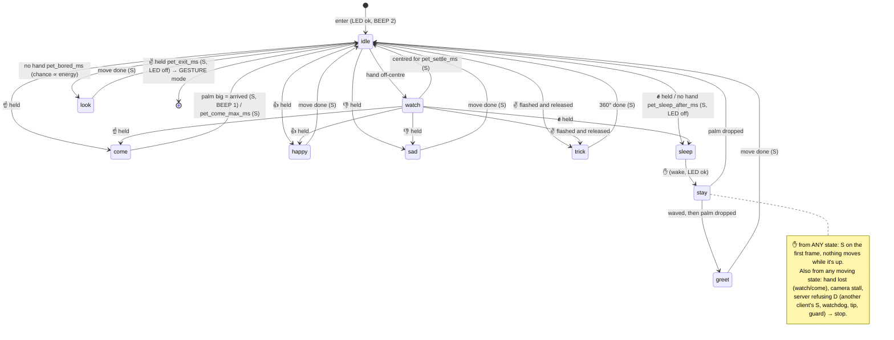

# iter3-pet/vision/: drive TARS with your hand (MediaPipe, on the Pi under QNX)

Three modes, cycled with a held peace sign ✌️ (GESTURE → FOLLOW → PET):

- **GESTURE**: ✋ stop · 👍/☝️ step forward · ✊/👇/👎 step back · 👈/👉 turn 30°
- **FOLLOW**: the rover steers toward your hand and drives until it's at
  arm's length. ✋ stops it, and losing the hand stops it.
- **PET** (iteration 3): it reacts to your hand like a small pet. 👋 wave = it wiggles
  hello · ✋ stay · ☝️ come here · 👍 happy spin · 👎 sad back-up · ✌️ flash = 360° trick
  (hold 2 s = leave) · ✊ hold = play dead · no hand = gets bored, looks around, then
  sleeps. It has a mood that rises and decays. ✋ still stops it from every state.
  [GESTURES.md §8](GESTURES.md#8-pet-mode-it-reacts-to-your-hand-like-a-small-pet),
  state machine in [§2d](#2d-pet-mode-iteration-3). **Mac-tested only.**
- **TEACH** 🤙 (hold 2 s, or the Uno button): show it a pose it has never seen,
  pick an action by showing an existing gesture, and from then on that pose
  drives the robot. It learns on the Pi in seconds, with no retraining, and it
  says "don't know" to poses it wasn't taught. [GESTURES.md §7](GESTURES.md#7-teach-a-new-pose-on-the-spot-no-screen-no-laptop)

**At runtime the robot is completely local:** Pi + camera + Uno. No laptop,
screen, keyboard or controller. `qnx/autostart/` starts everything at boot.
The Mac app is a dev and tuning tool only.

The rules and every number are in **[GESTURES.md](GESTURES.md)** and
**[gesture.conf](gesture.conf)**, shared by all three apps:

```
camera ─▶ MediaPipe HandLandmarker ─▶ classify ─▶ learned k-NN ─▶ Controller ─▶ TCP :5555 ─▶ tars_motor (iter1-wasd/pi/) ─▶ Uno ─▶ wheels
          (21 points, 1 hand)          (rules)    (only if rules   (mode, debounce,     D l r / S / VIS / LED / BEEP
                                                   say unknown)     moves, follow,       ◀── STATUS btn_teach= (Uno button)
                                        └──── teach state machine ─┘ fail-safes)
```

| App | Runs on | Camera | Status |
|---|---|---|---|
| `desktop/gesture_drive.py` | Mac | OpenCV webcam | **tested** (unit, parity, end-to-end with real MediaPipe + stub server) |
| `qnx/python/tars_gesture.py` | Pi, QNX | libcamapi (QNX codelab helper) | written, **not run on QNX yet** |
| `qnx/cpp/tars_gesture.cc` | Pi, QNX | libcamapi (qnx-ports `qnx_defs`) | written + type-checked against stub headers, **not built yet** |

**Which Pi app?** Start with the **Python** one. QNX ships MediaPipe prebuilt
(`apk add mediapipe`), so it needs no compiling. The C++ app is the
"no Python in the loop" version for the judges. It has to be built on the Pi
with Bazel (hours), so start that build early and in parallel.

MediaPipe and the hand landmarker model are Apache 2.0, free to use.

---

## 1. Mac: try it now (tune your gestures here)

```sh
cd vision
uv venv --python 3.11 .venv && uv pip install --python .venv/bin/python -r desktop/requirements.txt
#   (or: python3.11 -m venv .venv && .venv/bin/pip install -r desktop/requirements.txt)
./get_model.sh

.venv/bin/python desktop/gesture_drive.py               # DRY RUN: prints commands, overlay window
```

macOS will ask for camera permission for your terminal the first time
(System Settings → Privacy & Security → Camera).

The window shows the mode (GESTURE blue / FOLLOW yellow), the label it sees,
the hand skeleton and the two wheel bars. In FOLLOW it also shows the centre
deadband and the current vs target hand size. The bottom line shows fps,
inference ms, camera→command ms and the last palm→STOP ms.
Keys: `q` quit · `space` stop · `m` switch mode · `p` pause · `t` teach (= Uno button) · `f` forget all.
While teaching, a banner shows the step. The bar under the title shows the nearest
learned pose and its confidence. Green means accepted; red means UNKNOWN, and the white tick is the 0.5 cutoff.

Tune without editing files: `--set stable_frames=3 --set follow_target_size=0.25`.
Copy the values you like into `gesture.conf`.

**Against the motor server, no robot needed:**
```sh
make -C iter1-wasd/pi host && iter1-wasd/pi/build/tars_motor_host -b stub          # terminal 1: prints wheel commands
iter3-pet/vision/.venv/bin/python iter3-pet/vision/desktop/gesture_drive.py --host 127.0.0.1   # terminal 2
printf 'STATUS\n' | nc 127.0.0.1 5555                          # shows vis=… stop_ms=…
```

**Tests:**
```sh
python3 iter3-pet/vision/tests/test_gesture.py            # 40 unit tests: classifier, steps, follow, mode toggle/cycle
python3 iter3-pet/vision/tests/test_learn.py              # 35: invariance, few-shot, rejection, teach state machine (fake motor)
python3 iter3-pet/vision/tests/test_pet.py                # 38: pet states, mood, stop-wins from every state, bounds, sleep/wake
python3 iter3-pet/vision/tests/test_parity.py             # Python vs C++ (gesture/learn/pet .hpp): identical output + JSON
iter3-pet/vision/.venv/bin/python iter3-pet/vision/tests/test_runtime_teach.py   # real runtime: ticker, button polling, save/reload
python3 iter3-pet/vision/tests/bench_learn.py             # µs per frame for the learned-pose classifier
iter3-pet/vision/tests/check_cpp_syntax.sh                # tars_gesture.cc type-checks (stub MediaPipe headers)
iter3-pet/vision/.venv/bin/python iter3-pet/vision/tests/e2e_desktop.py   # real MediaPipe on real hand photos -> stub server
make -C iter1-wasd/pi test                                  # server incl. hard-stop S + VIS (116 checks)
```
or all of them: `iter3-pet/vision/tests/run_all.sh`.

---

## 2. Pi: Python app (fast path)

Needs the **QNX 8.0.5 QSTI** Pi 5 image (it has `apk`, QNX's MediaPipe package and Screen).
The C270 already works with `sensor -U usb_camera.conf` + `camera_example3_viewfinder`.

```sh
# Mac
iter3-pet/vision/qnx/deploy.sh                            # PI_HOST=qnxuser@<ip> if tars.local doesn't resolve
make -C iter1-wasd/pi deploy                               # tars_motor with the new S/VIS hook

# Pi (ssh qnxuser@tars.local)
cd /data/home/qnxuser/vision
sh qnx/setup_pi.sh                              # once: apk add mediapipe, camera helper, model
python3 qnx/python/tars_gesture.py --list-units # which camera unit the C270 is
python3 qnx/python/tars_gesture.py --dry-run --save-every 30   # look at gesture_view.jpg (scp it back)

# drive: tars_motor in one ssh, the vision app in another
/data/home/qnxuser/tars_motor -b uno -d /dev/serusb1        # (or: make -C iter1-wasd/pi run from the Mac)
python3 qnx/python/tars_gesture.py --unit <N>
```

The log looks like this (from the Mac end-to-end run; Pi numbers will differ):
```
[cmd] D 0.50 0.50    forward        mode=gesture
[cmd] S              mode_follow    mode=follow
[status] mode=follow fps=26.9 infer=7ms cam->cmd=17ms palm->stop=- see=fist wheels=+0.07,+0.49 link_rtt=0.3ms
[cmd] S              palm           mode=follow
[lat] PALM -> STOP: camera frame -> S acked in 6 ms
```
and the server's `STATUS` shows `stop_ms=… vis=follow vis_fps=… vis_cam_ms=… vis_stop_ms=… vis_see=fist`.

**Expected fps on the Pi 5 CPU** (estimate, not measured): MediaPipe's hand
landmarker runs about 10–20 fps at 320 px wide. QNX's own face-detection
codelab reports 25 fps on the Pi 5 with a lighter model. If it's under 8 fps:
`--set infer_width=256`, and `--set stable_frames=3` so moves still feel snappy.

## 2b. Teach demo (the judges' script)

1. "TARS knows a few hand signals. Let's teach it one it's never seen. You make one up."
2. The judge holds 🤙 for 2 s. TARS wiggles: "I'm listening." It nudges once a second
   while counting down; the judge lowers the 🤙 and gets their pose ready.
3. Beep-beep: the judge holds their invented pose (say 🤘, or three fingers) for ~2 s.
   TARS does a double wiggle: "got it, what does it mean?"
4. The judge shows ✌️ (= spin). TARS spins once to confirm.
5. The judge makes their pose again and TARS spins. It works from any distance, any tilt, either hand.
6. "Now a random hand": a half-curled claw, or a different made-up pose. **Nothing happens.**
   (Desktop overlay: red UNKNOWN bar.) It knows what it doesn't know.
7. Try to teach it a fist: the "no" head-shake (`too_similar fist`). Built-ins are protected, and ✋ always stops it.
8. Pitch line: *"Learned on the robot, in seconds, from 40 frames; classifying a frame takes
   16 µs in C++ (640 µs in Python) for 4 learned poses on top of MediaPipe, inside QNX's
   real-time loop with a hard ✋ stop."* (Mac numbers from `tests/bench_learn.py`; measure on the Pi for the slide.)

Reset between judges: hold 🤙 for 5 s (forget all), or long-press the Uno button.
Poses persist across reboots in `/data/home/qnxuser/vision/learned.json` (`deploy.sh` never overwrites it).

## 2c. Autostart at boot (no laptop)

```sh
# Pi, once
cd /data/home/qnxuser/vision/qnx/autostart
cp tars.env.example tars.env && vi tars.env   # MOTOR_ARGS (Uno serial device), GESTURE_ARGS (--unit N), CAMERA_CMD
sh tars_autostart.sh run        # foreground test: starts camera service (if set), tars_motor, gesture app
sh install_autostart.sh         # adds "sh .../tars_autostart.sh start &" to the image's boot script
# reboot, then
sh tars_autostart.sh status     # motor: running / gesture: running + last log lines
```
- Each process runs under a supervisor loop: if it exits it's restarted (1 s, 2 s … 10 s backoff),
  and the restart is logged in `logs/autostart.log`.
  While the vision app is down, tars_motor's 500 ms watchdog has already stopped the wheels.
- Logs: `/data/home/qnxuser/logs/{motor,gesture,camera,autostart}.log`, rotated at ~2 MB.
- `CAMERA_CMD`: paste the exact `sensor …` command that made `camera_example3_viewfinder`
  work. Leave it empty if the image already starts the sensor service at boot.
- **Not verified on QNX yet:** which boot script your image runs. The installer tries
  `/etc/rc.d/rc.local` then `/system/etc/startup/post_startup.sh`. If neither exists it
  says so; add the line to whatever your image runs at boot. The supervisor itself was tested on macOS `sh`.
- Paths in `tars.env` must not contain spaces (the default `/data/home/qnxuser` is fine).

## 2d. Pet mode (iteration 3)

```sh
.venv/bin/python desktop/gesture_drive.py --pet               # Mac, dry run (overlay shows PET:<state> + energy bar)
python3 qnx/python/tars_gesture.py --pet                      # Pi, Python app
qnx/cpp/tars_gesture_cpu --pet --model=… --conf=gesture.conf  # Pi, C++ app (the robot path)
```
Or hold ✌️ to cycle into it from FOLLOW, or set `pet_start = 1` / `GESTURE_ARGS="--pet"` in `tars.env`.
The rules and the stop/bound table are in [GESTURES.md §8](GESTURES.md#8-pet-mode-it-reacts-to-your-hand-like-a-small-pet).
The log prints `[pet] <event> (energy …)`, and `STATUS` on tars_motor shows `vis=pet:<state>`.


`happy` at energy ≥ `pet_excited` is the full 360° "zoomies". Every body segment is clamped
to `pet_max_speed` and `pet_max_seg_ms`, and `come` to `pet_come_max_ms` per command.

**Not run on the Pi/QNX or with a real camera/hand.** Tested on the Mac only: `tests/test_pet.py`
(synthetic labels) and `tests/test_parity.py` (synthetic MediaPipe hands, Python vs C++ identical).
Expect to tune `pet_wave_amp`, `pet_come_size` and the speeds on the real robot.

## 3. Pi: C++ app (`qnx/cpp`)

Built **on the Pi** inside QNX's MediaPipe port, exactly as in QNX's
[MediaPipe Camera Sample codelab](https://qnx.github.io/codelabs/mediapipe-camera-sample/).
It's not cross-compiled in our Docker toolchain, because the port carries its own QNX Bazel toolchains.

```sh
# Pi
cd /data/home/qnxuser/vision
bash qnx/cpp/build_on_pi.sh        # apk add bazel6 …; clones qnx-ports/mediapipe (qnx-v0.10.26) to ~/mediapipe;
                                   # copies tars_gesture.cc + BUILD + gesture.hpp into mediapipe/examples/qnx/;
                                   # runs QNX's build_qnx_examples.sh answering "y" only for ours
qnx/cpp/tars_gesture_cpu --model=models/hand_landmarker.task --conf=gesture.conf --dry_run
qnx/cpp/tars_gesture_cpu --model=models/hand_landmarker.task --conf=gesture.conf --camera_unit=<N>
```
`BAZEL_JOBS=2` if the build runs out of memory. Same log format, same `VIS` report.
The camera code is QNX's `qnx_defs.cc`, which accepts NV12, YCbYCr (YUYV), CbYCrY,
RGB888, RGB8888 and BGR8888, so the C270's packed YUV is covered.

---

## 4. Fallback: vision on the laptop, motors on the Pi

If neither Pi app works in time, run the Mac prototype against the robot over Wi-Fi.
It uses the same logic, commands and fail-safes, with only the camera moved:
```sh
iter3-pet/vision/.venv/bin/python iter3-pet/vision/desktop/gesture_drive.py --host tars.local
```
Point the Mac webcam (or an iPhone via Continuity Camera, `--camera 1`) at
yourself. In FOLLOW mode the camera should ride on the robot, so use the laptop
for GESTURE mode. Wi-Fi adds roughly 5–30 ms of `link_rtt`, which is shown in the log.

---

## 5. Troubleshooting

| Symptom | Fix |
|---|---|
| `setup_pi.sh`: no `apk` | Not the 8.0.5 QSTI image. Reflash, or use the fallback (§4) |
| `--list-units` is empty | the sensor service isn't running your USB config: `sudo pidin ar \| grep sensor`, then `sensor -U usb_camera.conf …` as in your viewfinder test |
| `frame timeout` lines | another app has the camera open (close `camera_example3_viewfinder`), or the wrong `--unit` |
| colours swapped / purple view | `--packed-order uyvy` (Python app; the first frame logs `frametype=…`) |
| `unexpected descriptor` error | the Python helper can't decode that frame type. Use the C++ app (QNX's decoder) or set the sensor config to NV12 |
| labels flicker | more light, plain background; `--set stable_frames=5`; check `gesture_view.jpg` |
| point left/right swapped | `point_left_is_left = 0` |
| follow steers away from the hand | `follow_invert_turn = 1` |
| follow overshoots / wobbles | lower `follow_kp_turn`, raise `follow_deadband` |
| creeps when the hand is still | raise `follow_size_deadband` |
| `[link] … ERR tipped over` | stand it up, send `RESET` (`python iter1-wasd/laptop/tars_client.py`) |
| turns aren't 30° | `desktop/calibrate_turn.py --host tars.local` (12 turns = 360°) |
| 🤙 doesn't start teaching | check `gesture_view.jpg`/log `[see] teach`. The pinky must be clearly out and the other three folded. Or use the Uno button |
| new pose always `too_similar …` | it reads as that built-in in ≥ 30% of frames. Pick something more different, or raise `learn_builtin_frac` |
| learned pose fires on other hands | lower `learn_thr_max` / `learn_thr_mult`; check the `match=pose1:0.xx` values in `[status]` |
| learned pose not recognised | re-teach in the demo lighting; raise `learn_thr_min` a little (0.45 → 0.6) |
| robot never stops after reboot | `sh qnx/autostart/tars_autostart.sh stop` (or ✋, always) |

## 6. Layout

```
gesture.conf          all tuning (both languages read it; unknown keys are an error)
GESTURES.md           the rules
get_model.sh          hand_landmarker.task (float16, 7.8 MB, sha256-checked)
common/gesture.py     classifier + controller (pure Python)
common/gesture.hpp    the same in C++17 (header-only)
common/learn.py       teach-on-the-spot: features, k-NN, teach state machine (Brain), JSON
common/learn.hpp      the same in C++17
common/pet.py         pet mode (iteration 3): states, mood, body language (pure Python)
common/pet.hpp        the same in C++17
learned.json          learned poses (created on the robot; not in git)
common/app.py         MediaPipe runtime + ticker + status/VIS (Python apps)
common/link.py        TCP client with reconnect / dry run
desktop/              gesture_drive.py (Mac), calibrate_turn.py, requirements.txt
qnx/python/           tars_gesture.py, qnx_cam.py (+ vendor/qnx_camera_helper.py from setup_pi.sh)
qnx/cpp/              tars_gesture.cc, BUILD, build_on_pi.sh
qnx/deploy.sh         Mac → Pi copy;  qnx/setup_pi.sh  one-time Pi setup
qnx/autostart/        tars_autostart.sh (boot supervisor), tars.env, install_autostart.sh
tests/                unit, learn, parity, runtime-teach, bench, C++ syntax, end-to-end (handgen.py makes synthetic hands)
```

### Server hook (iter1-wasd/pi/src/main.c)
- `S` is now a **hard stop**: the wheels go to 0 on the next tick with no slew (before, it slewed down over ~140 ms).
  `STATUS` reports `stop_ms=` (S received → wheels commanded 0).
- New `VIS <mode> <fps> <cam_ms> <stop_ms> <label>`: the vision app reports
  about once a second. `STATUS` shows `vis= vis_fps= vis_cam_ms= vis_stop_ms= vis_see= vis_age_ms=`.
  It does not feed the watchdog.
